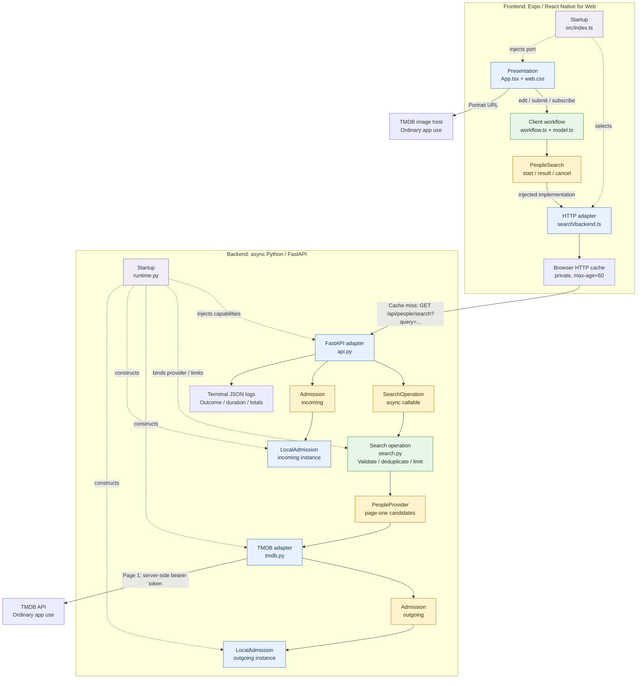
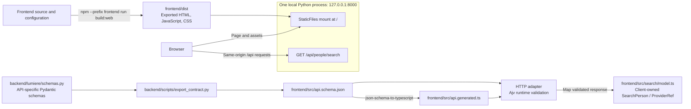
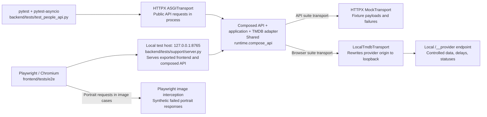

# Lumiere: Search people architecture

Current implementation as of 2026-11-12 (Pacific/Honolulu), including the approved ports-and-adapters refactor, search reset/focus revisions, and provider-free testing policy. This describes the local feature; production hosting and native delivery remain separate work.

## Runtime modules, ports, and adapters

Open the [runtime diagram as an SVG](architecture.svg) for zooming or export.

Solid arrows show calls or data flow. Dashed arrows show startup selection and injection. Yellow nodes are application-owned ports; green nodes contain application workflow rules. Ports are interfaces within the same application, not separate processes.

The external TMDB nodes below apply to ordinary app use. Automated tests replace those connections as shown in the test diagram.

Expo registers the root directly; this single-screen feature does not use Expo Router. The screen creates and disposes its own workflow for each mount. Frontend startup supplies the port implementation; backend startup constructs adapters, binds the search operation, and injects incoming admission and the usage-counter callback into FastAPI. The client workflow does not import React, Expo, fetch, or generated API response types. The backend application operation imports only ordinary Python types and its own interfaces. Both incoming and outgoing admission use the same port with independent local instances.

| Interface | Owner and implementation |
| --- | --- |
| `PeopleSearch.start(name)` returns `{ result, cancel }` | [Client workflow](../../frontend/src/search/workflow.ts); implemented by the [HTTP adapter](../../frontend/src/search/backend.ts) |
| `SearchOperation(name)` asynchronously returns selected people | [Backend application](../../backend/lumiere/search.py); startup binds `search_people` to the provider and configured name limit |
| `PeopleProvider.search_people(name)` returns usable page-one candidates | [Backend application](../../backend/lumiere/search.py); implemented by [TmdbPeople](../../backend/lumiere/tmdb.py) |
| `Admission.acquire()` / `release()` | [Backend application](../../backend/lumiere/search.py); implemented by [LocalAdmission](../../backend/lumiere/admission.py) |

## Contracts, build, and local serving

Provider payloads, backend application data, API responses, and frontend application data have separate representations. The API contract is generated from Pydantic; the HTTP adapter validates it with Ajv and translates snake-case wire fields into the client model's camel-case fields.

- A successful response contains only `results`, with zero to seven rows: `provider_ref`, `name`, nullable `portrait_url`, nullable `department`, and zero to three `known_for` title strings. The provider reference contains `provider`, `entity_type`, and a string `id`.
- Backend application results use frozen Python dataclasses. Frontend workflow results use its own TypeScript model (`providerRef`, `portraitUrl`, `knownFor`). Generated API types stay in the HTTP adapter.
- Success, including no matches, returns HTTP 200 with `Cache-Control: private, max-age=60`. Rejected input, denied admission, and failed requests return HTTP 500 with `Cache-Control: no-store`.
- There is no application-owned query cache, server query-result cache, feature-data persistence, database prerequisite, or app-owned Person identity creation. Normalized provider references identify transient results.
- In the current local setup, stopping Python stops serving both the API and exported frontend. A separate static frontend host/CDN is a future deployment option, not an implemented part of this feature.

## Search lifecycle and presentation

```mermaid
stateDiagram-v2
    [*] --> Initial
    Initial: Examples visible; no submitted search
    Loading: Old rows cleared; inline spinner
    Results: Up to seven recognition rows
    Empty: No rows, examples, or failure message

    Initial --> Loading: Submit a nonblank name
    Loading --> Loading: Newer submission supersedes older work
    Loading --> Results: Latest success has usable matches
    Loading --> Empty: Latest success has no matches, or request fails
    Results --> Loading: Submit a nonblank name
    Empty --> Loading: Submit a nonblank name
    Loading --> Initial: Clear input or leave only whitespace
    Results --> Initial: Clear input or leave only whitespace
    Empty --> Initial: Clear input or leave only whitespace

    note right of Loading
        Nonblank draft edits do not submit or cancel.
        New submission or clearing cancels old work when possible.
        Request generations reject every stale completion.
    end note
```

Enter/Return, the search icon, and an example shortcut submit manually. Submission trims surrounding whitespace and preserves accents/internal spaces. A nonblank draft edit retains the existing outcome; completion preserves the current draft. Clearing restores usable examples without a request, and unmount prevents late updates. A fresh mount starts at Initial. Client cancellation does not guarantee that already-started provider work was avoided or rolled back.

The search box emphasizes its existing border while either its input or search button has focus. Portrait failures and missing portraits share one placeholder. Optional department and recognition labels omit empty text and separators. Movies and Follow remain disabled; Follow is revealed on hover/keyboard focus or by touch toggle, with at most one touch selection. Rows do not navigate or save activity.

## Automated test topology: no live provider servers

These are alternative test transports, not simultaneous provider attempts. The API suite also injects a supplied `SearchOperation`/admission implementation and a replacement `PeopleProvider` to verify the application interfaces directly through the public API. Browser cache/header behavior is exercised against the local API with ordinary browser caching.

**Tests require no real provider credentials and contact no provider API or image servers.** The live smoke script and command were removed. Earlier live-check results are historical; any future live-provider testing requires an explicit request. The current suites contain 27 API and 27 browser tests.

## Resource bounds and operational output

These are normal runtime defaults; the test harness supplies its own local settings.

| Concern | Current implementation |
| --- | --- |
| Interactive deadlines | Client: 8 seconds; API operation: 6 seconds; provider: 5 seconds. Configuration requires provider < operation and operation at most 7 seconds. |
| Input and response bounds | Trimmed name: 200 Unicode code points; encoded request target: 4096 bytes; search bodies rejected; provider response: 1 MiB decoded bytes. |
| Admission | Incoming concurrency: 8; outgoing concurrency: 4. Each direction permits 60 admissions per rolling minute and 1000 cumulative admissions until process restart. Refusal is immediate. |
| Provider usage | One attempt to `/3/search/person` on page 1; no retries, pagination refill, or detail requests. Language and adult options remain unset. |
| Operational logs | Python INFO JSON events: operation, outcome, elapsed milliseconds, incoming admission total, provider attempt total. Counters come from startup; logging stays outside the application core. |
| Content exclusion | No searched names, returned person content, credentials, or full query-string access logs. HTTPX/HTTP Core and Uvicorn access logs are disabled. |
| Current delivery scope | Local, single-process accounting; public deployment, durable global accounting, Logfire integration, and native release remain separate work. |

## Development tooling

| Area | Backend | Frontend |
| --- | --- | --- |
| Dependency tooling | uv; `pyproject.toml` and `uv.lock` | npm; `package.json` and `package-lock.json` |
| Typechecking | ty | TypeScript `tsc --noEmit` |
| Linting | Ruff, including C90 with maximum complexity 10 | ESLint with Expo preset and maximum complexity 10 |
| Formatting | Ruff formatter | Prettier plus ESLint compatibility config |
| Behavioral tests | pytest + pytest-asyncio at the public API | Playwright Chromium at the rendered workflow |
| Coverage | pytest-cov; branch option enabled by default when collecting coverage | Coverage measurement not yet configured |

References: [feature spec](spec.md), [implementation evidence](implementation.md), [architecture review](architecture-review.md), [startup and verification commands](../../README.md), and [ADR-0001](../../docs/adr/0001-app-architecture.md).
