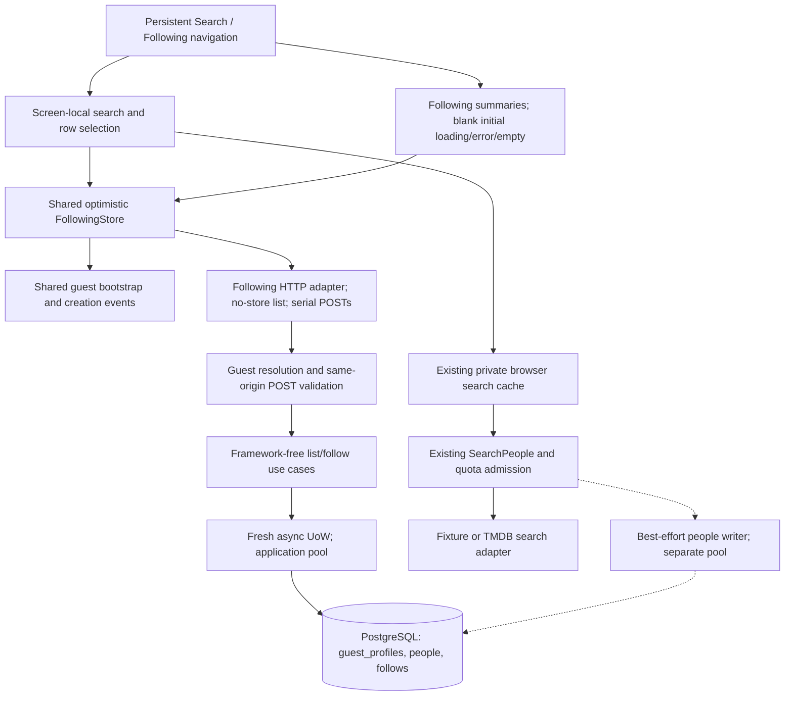

# F002 following architecture

Implemented from the [approved F002 design](../superpowers/specs/2026-11-23-F002-follow-people-design.md), 2026-11-23. Guests can follow up to three existing people. Search remains an independent, privately browser-cacheable catalog query.

## HTTP contracts

`GET /api/v1/following` returns `200` with `{"people":[],"limit":3}` for an empty guest. `POST /api/v1/following` accepts exactly `{"provider":"tmdb","provider_id":4139}` and returns the complete saved snapshot. Each person has the same six public summary fields as search: `provider`, `provider_id`, `name`, `known_for_department`, `profile_image_url`, and `known_for`. Internal person/profile IDs are never returned. IDs must be strict integers in `1..2^53-1`; extra fields and unsupported providers fail before following storage work.

Both operations use existing guest-cookie resolution and return `Cache-Control: no-store` on success and failure. POST applies existing origin protection. Every failure returns an empty `500`, including missing person/profile, invalid identity/body/origin, cap, storage, and deadline failures. There is no `422` response advertised for these operations. Follow/list makes no provider call, changes no people summary, and incurs no provider usage charge. Undecodable JSON follows the same empty failure contract as schema validation. The seven-second server and eight-second transport deadlines remain bounded.

Guest bootstrap retains its empty `200`, cookie renewal, and no-store behavior, adding `X-Lumiere-Guest-Created: true|false`. Only a current successful `true` bootstrap advances client identity generation; readiness invalidation and returning-guest bootstrap preserve following state. A new guest clears old confirmed/pending data, aborts old reads/saves, discards unsent queue entries, ignores obsolete responses, and loads its own following before enabling actions.

## Durable transaction

Migration `0008_follows` adds `follows(profile_id uuid, person_id bigint, followed_at timestamptz)`, with a composite primary key, foreign keys to `guest_profiles` and `people`, and `clock_timestamp()` assigned at insertion. Upgrade preserves existing data; downgrade removes only follows.

Every mutation awaits connection checkout, transaction work, and commit. It locks the resolved guest profile with `SELECT ... FOR UPDATE`, rejects a deleted profile, resolves `tmdb_id` to the existing app-owned person, checks membership before the cap, and inserts only below three. An existing follow succeeds even at three without changing its timestamp. The profile lock serializes all follow mutations across processes; checking the cap and inserting happen in one transaction. A missing person returns `500` immediately, without waiting for best-effort persistence or creating/hydrating anything.

GET joins membership and current catalog summaries in one query. POST obtains that snapshot before commit and returns only after commit succeeds. Both order by `followed_at DESC, person_id DESC`. Current summaries can change independently of follow ownership and timestamps. Async SQLAlchemy/psycopg operations yield while waiting for database locks; cancellation uses existing transaction/connection cleanup. Following uses the `application` pool; `people_writer` stays dedicated to background catalog summaries. Existing single-process search-accounting deployment limits still apply.

## Client and input lifecycle

One store above both routes owns confirmed summaries and a bounded serial queue. Accepted clicks immediately add unique pending identities; the unique confirmed-plus-pending count hides all remaining `Follow +` actions at three. Duplicated search identities share pending/saved status while positional row identities keep touch selection independent. Pending rows appear first in most-recent-click order, using the search summary until the server supplies its current summary.

Each settlement removes only its pending entry and overlays the remaining entries on the new confirmed snapshot. A failed save, including lost delivery after commit, rolls back locally and restores eligibility. It causes no automatic retry or reconciliation GET. An explicit user retry is idempotent, even at the server cap. GET refreshes occur only at app startup, Following route entry, and new guest creation. Search route entry, browser focus/visibility changes, and native foreground events do not refresh following. Between those reads, the shared in-memory store tracks follows locally and adopts the authoritative full snapshot returned by each successful follow POST. Failed refreshes retain confirmed data. Revision/generation guards reject obsolete reads and old-guest responses. An explicit ordinary refresh supersedes an outstanding read from an obsolete mutation revision. A failed list marks bootstrap readiness stale for the next ordinary operation, preserving confirmed data and causing no immediate retry; failed POSTs do not invalidate readiness. Restarting the store compares guest generation so creation events missed while stopped cannot expose old follows.

Mouse hover reveals a row's action and keeps it visible when moving into the control. Eligible invisible controls remain keyboard reachable with a visible focus border; Enter/Space activates the button. Actual keyboard focus transfers to the pending/saved status and back on rollback, unless the user has moved focus elsewhere. Touch selects at most one row: first completed tap reveals, second tap on its visible button saves. A first tap at an invisible button cannot save. Another row replaces selection, outside touch dismisses without consuming navigation/control activation, and moved/cancelled gestures do not select or save. Touch-origin focus and hover cannot resurrect dismissed actions. `Following` is accessible status with the same reveal rules and no mutation.

The sidebar always offers `/` and `/following`. Both direct entry and browser history work. Following renders no indicator, initial error copy, empty-state message, or Unfollow action. Leaving Search resets draft/results/selection and cancels pending search even if the router retains the screen; pending follows survive navigation. Constructors and server rendering perform no network I/O.

## Verification and deferred work

Use `make test`, `make lint`, `make test-integration`, `make test-e2e`, `npm --prefix e2e run typecheck`, and deterministic `make generate`. Persistence tests use disposable PostgreSQL for constraints, migrations, concurrent cap/idempotency, ordering, lock-wait event-loop progress, cancellation, rollback, and durability through a fresh engine. Browser tests use the fixture provider, including real touch and a committed-but-lost response. Real browser cache tests use no routing, HAR, service worker, or cache mocks.

The search writer can drop or lag a summary; missing-person follow failure is accepted. Follow-time hydration, details/filmographies, timeline delivery, Unfollow, registration/account prompts, cross-tab synchronization, and native release remain deferred. Future hydration planning must cover both existing and newly created follows; no hydration intent/worker is introduced here. Sanitized `http.following.list`, `http.following.follow`, `following.list`, and `following.follow` spans retain finite failure categories without names, identities, bodies, or raw errors.
