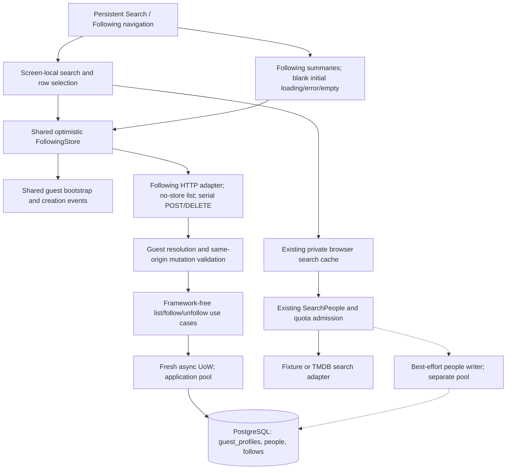

# F002 following architecture

Implemented from the [approved F002 design](../superpowers/specs/2026-11-23-F002-follow-people-design.md), 2026-11-23. The [approved unfollow amendment](../superpowers/specs/2026-11-23-F002-unfollow-people-design.md) extends F002 with removal. Guests can follow up to three existing people. Search remains an independent, privately browser-cacheable catalog query.

## HTTP contracts

`GET /api/v1/following` returns `200` with `{"people":[],"limit":3}` for an empty guest. `POST /api/v1/following` accepts exactly `{"provider":"tmdb","provider_id":4139}` and returns the complete saved snapshot. Each person has the same six public summary fields as search: `provider`, `provider_id`, `name`, `known_for_department`, `profile_image_url`, and `known_for`. Internal person/profile IDs are never returned. IDs must be strict integers in `1..2^53-1`; extra fields and unsupported providers fail before following storage work.

DELETE accepts the same identity-only JSON body and returns empty `204` with no JSON content type, including an absent relationship or local catalog person. All three operations use existing guest-cookie resolution and return `Cache-Control: no-store` on success and failure. POST and DELETE apply existing origin protection. Every failure returns an empty `500`, including POST missing profile/person, invalid identity/body/origin, cap, storage, and deadline failures. There is no `422` response advertised for these operations. Follow/unfollow/list makes no provider call, changes no people summary, and incurs no provider usage charge. Undecodable JSON follows the same empty failure contract as schema validation. The seven-second server and eight-second transport deadlines remain bounded.

Guest bootstrap retains its empty `200`, cookie renewal, and no-store behavior, adding `X-Lumiere-Guest-Created: true|false`. Only a current successful `true` bootstrap advances client identity generation; readiness invalidation and returning-guest bootstrap preserve following state. A new guest clears old confirmed/pending data, aborts old reads/saves, discards unsent queue entries, ignores obsolete responses, and loads its own following before enabling actions.

## Durable transaction

Migration `0008_follows` adds `follows(profile_id uuid, person_id bigint, followed_at timestamptz)`, with a composite primary key, foreign keys to `guest_profiles` and `people`, and `clock_timestamp()` assigned at insertion. Upgrade preserves existing data; downgrade removes only follows.

Every mutation awaits connection checkout, transaction work, and commit. Under the [approved Follow query simplification](../superpowers/specs/2026-11-23-F002-follow-query-simplification-design.md), POST uses three SQL statements: lock the resolved guest profile with `SELECT ... FOR UPDATE`, insert idempotently while resolving `tmdb_id`, and read the resulting following list. A missing profile fails before insertion. The insert uses a data-modifying CTE with `INSERT ... SELECT ... ON CONFLICT (profile_id, person_id) DO NOTHING`, reporting local person existence even when the membership already exists. A missing person returns `500` immediately, including at the cap, without waiting for best-effort persistence or creating/hydrating anything. If the resulting list exceeds three, the use case rejects and rolls back the speculative insertion; otherwise it commits before returning. No fourth membership is committed or visible outside that transaction. An existing follow succeeds even at three without changing its timestamp. The retained profile lock serializes Follow additions across processes. These statement counts exclude guest identity resolution, transaction commands, and connection health checks.

DELETE executes one parameterized `DELETE FROM follows USING people`, joining the local person ID and filtering the resolved profile ID and requested `tmdb_id`. It takes no profile lock and performs no separate profile/person lookup. An absent profile, person, or relationship is an idempotent no-op that still commits after guest identity resolution; missing/invalid credentials remain failures. It preserves unrelated timestamps and ownership; no migration is needed. This is the owner's approved simplification of the original locked Unfollow transaction.

Follow retains its profile lock and three-person cap. Concurrent Follow/Unfollow requests across clients use PostgreSQL visibility and row-lock timing rather than a shared profile-lock order. In particular, Unfollow can delete zero rows and commit while a concurrent insertion is still uncommitted; that Follow may subsequently commit and remain. The shared client mutation queue still preserves click order within one application instance.

GET joins membership and current catalog summaries in one query. POST obtains that snapshot before commit and returns only after commit succeeds. Both order by `followed_at DESC, person_id DESC`. Current summaries can change independently of follow ownership and timestamps. Async SQLAlchemy/psycopg operations yield while waiting for database locks; cancellation uses existing transaction/connection cleanup. Following uses the `application` pool; `people_writer` stays dedicated to background catalog summaries. Existing single-process search-accounting deployment limits still apply.

## Client and input lifecycle

One store above both routes owns confirmed summaries and one serial queue of chronological follow/unfollow intents, including the active request. Replaying intents inserts absent follows at the front and removes unfollowed identities. Unfollow immediately removes the row and frees a slot; projected counts at or above three hide further `Follow +` actions. Duplicated search identities share pending/saved status while positional row identities keep touch selection independent. Pending rows appear first in most-recent-click order, using the search summary until the server supplies its current summary.

Each settlement removes only its operation ID and replays later intents. POST replaces the confirmed snapshot; DELETE removes only its identity locally without body parsing. Follow/unfollow/follow of the same identity retains click order. A failed removal restores its original position; a provisional replacement remains queued, even if the projection temporarily has four people, until the server accepts or rejects it. A failed save, including lost delivery after commit, rolls back locally and restores eligibility. It causes no automatic retry or reconciliation GET. An explicit user retry is idempotent, even at the server cap. GET refreshes occur only at app startup, Following route entry, and new guest creation. Search route entry, browser focus/visibility changes, and native foreground events do not refresh following. Between those reads, the shared in-memory store tracks follows locally and adopts the authoritative full snapshot returned by each successful follow POST. Failed refreshes retain confirmed data. Revision/generation guards reject obsolete reads and old-guest responses. An explicit ordinary refresh supersedes an outstanding read from an obsolete mutation revision. A failed list marks bootstrap readiness stale for the next ordinary operation, preserving confirmed data and causing no immediate retry; failed POSTs and DELETEs do not invalidate readiness. Restarting the store compares guest generation so creation events missed while stopped cannot expose old follows.

Mouse hover reveals a row's action and keeps it visible when moving into the control. Mouse click focus does not keep the pending/saved status visible after leaving the row. Eligible invisible controls remain keyboard reachable with a visible focus border; Enter/Space activates the button. Actual keyboard focus transfers to the pending/saved status and back on rollback, unless the user has moved focus elsewhere. Touch selects at most one row: first completed tap reveals, second tap on its visible button saves. A first tap at an invisible button cannot save. Another row replaces selection, outside touch dismisses without consuming navigation/control activation, and moved/cancelled gestures do not select or save. Touch-origin focus and hover cannot resurrect dismissed actions. `Following` is accessible status with the same reveal rules, the same normal border as `Follow +`, and no mutation.

The sidebar offers Search (`/`), Timeline (`/timeline`), and Following (`/following`), reusing one screen instance per destination. Both direct entry and browser history work. Following renders shared Unfollow reveal actions; initial loading/error/empty states remain blank without an indicator or copy. A removed keyboard action temporarily moves focus to the surviving list; rollback restores it only if the user has not moved focus or left the route. Selection clears on route departure, row removal, and result replacement. Search retains its draft and results across sidebar visits, and pending searches may finish while away; clearing the input or unmounting still cancels pending search. Reload starts Search fresh. Pending follows survive navigation. Constructors and server rendering perform no network I/O.

## Verification and deferred work

Use `make test`, `make lint`, `make test-integration`, `make test-e2e`, `npm --prefix e2e run typecheck`, and deterministic `make generate`. Persistence tests use disposable PostgreSQL for constraints, migrations, concurrent cap/idempotency, ordering, lock-wait event-loop progress, cancellation, rollback, and durability through a fresh engine. Browser tests use the fixture provider, including real touch and a committed-but-lost response. Real browser cache tests use no routing, HAR, service worker, or cache mocks.

The search writer can drop or lag a summary; missing-person follow failure is accepted. Follow-time hydration, details/filmographies, timeline delivery, registration/account prompts, cross-tab synchronization, and native release remain deferred. Future hydration planning must cover both existing and newly created follows; no hydration intent/worker is introduced here. Sanitized `http.following.list`, `http.following.follow`, `following.list`, `following.follow`, `http.following.unfollow`, and `following.unfollow` spans retain finite failure categories without names, identities, bodies, or raw errors.

## F003 amendment, 2026-11-26

Timeline adds a third sidebar destination between Search and Following. Each valid follow request submits best-effort filmography work before starting the existing membership transaction. Provider attempts run asynchronously under the first accepted requester's usage allowance. Unfollow immediately changes timeline eligibility on the next read. The F002 transaction and client mutation contracts above describe the original increment. [F003 timeline architecture](timeline.md) · [Approved F003 design](../superpowers/specs/2026-11-25-F003-timeline-design.md)
