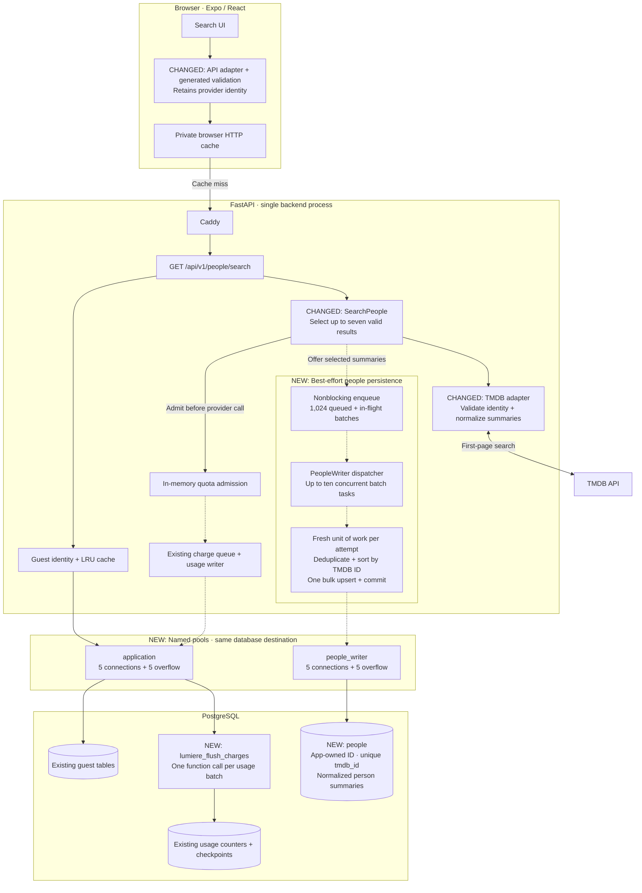

# People search: asynchronous persistence

Architecture of `feature/brainstorming/F002-follow-people` at `1bfb5ac`, compared
with `brainstorming` at `89f2a01`. Nodes marked **NEW** or **CHANGED** show the main
differences. Arrows show runtime calls or data flow; dashed arrows show background
persistence.

Search returns without waiting for person writes. Saturation, exhausted retries,
crashes, or shutdown expiry can lose a batch without failing search. Fresh browser
cache hits bypass the backend and enqueue nothing. Search continues to use TMDB;
the people table is not a search source.

Each persistence attempt has a five-second timeout, with at most three attempts
and a one-second delay between failures. Shutdown allows a five-second drain
before cancelling and awaiting remaining work. Separate pools isolate connection
checkout capacity, while sharing database CPU, locks, and server resources.

The API now carries `provider`, `provider_id`, and `known_for_department`; the
frontend maps the latter two to `providerId` and `knownForDepartment`. Search does
not expose the app-owned person ID. Following remains future work.

Source: [search orchestration](../../backend/src/lumiere/application/use_cases/search_people.py),
[PeopleWriter](../../backend/src/lumiere/application/people_writer.py),
[people repository](../../backend/src/lumiere/adapters/outbound/persistence/people_repository.py),
and [composition wiring](../../backend/src/lumiere/bootstrap.py).
See the [approved design](../superpowers/specs/2026-11-20-search-people-persistence-design.md)
and [full search architecture](search-people.md) for additional context.
