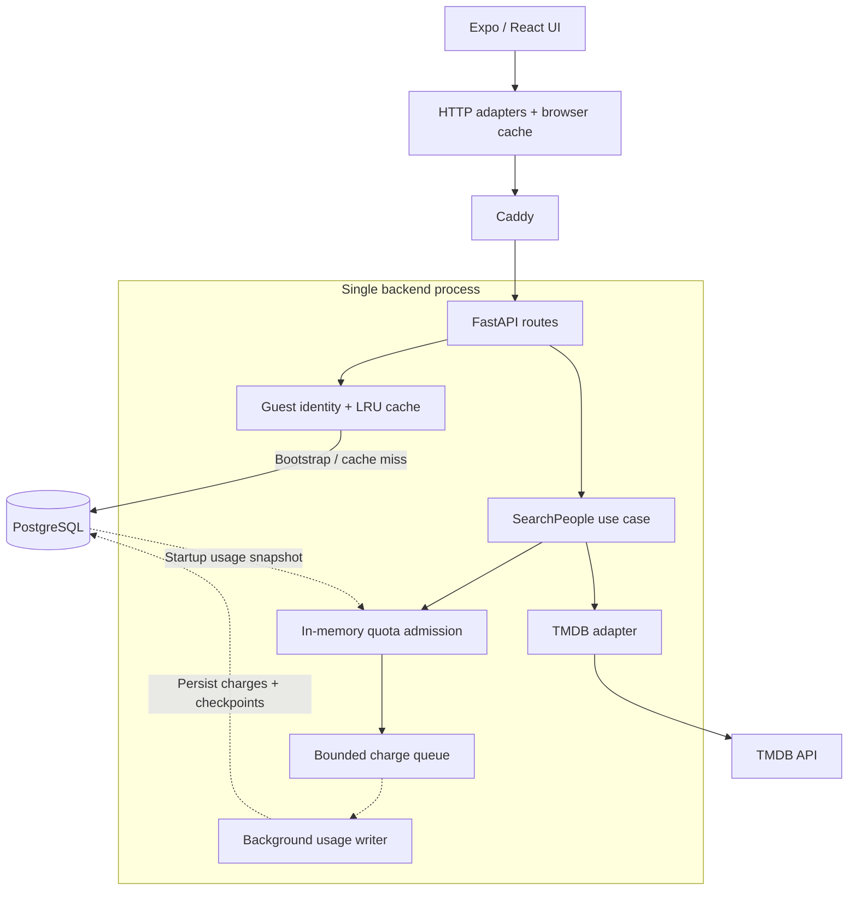
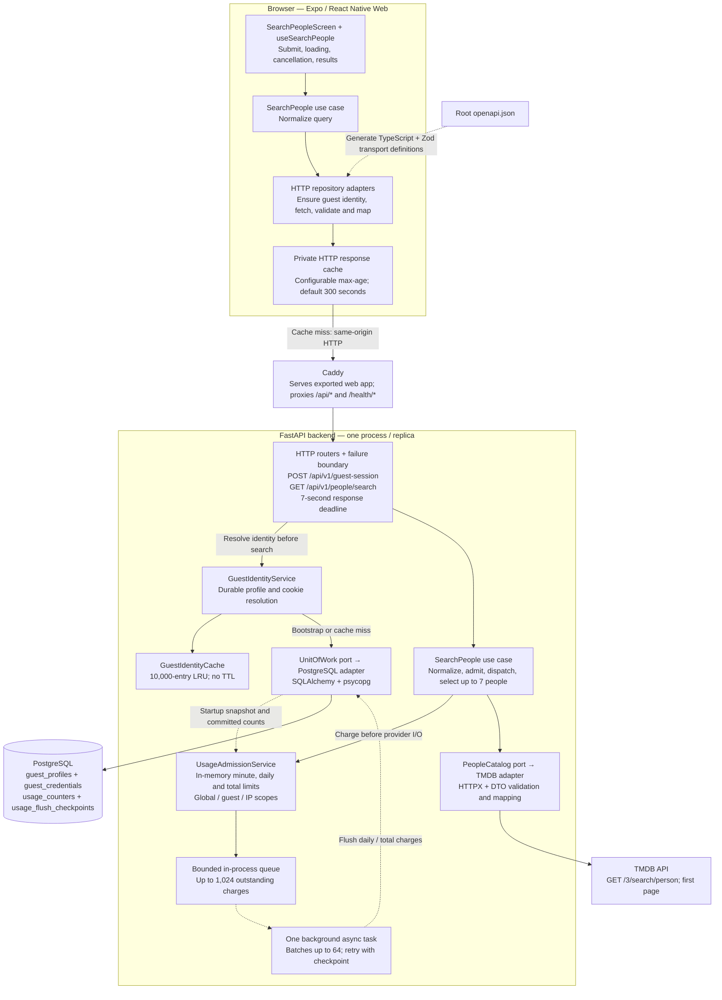
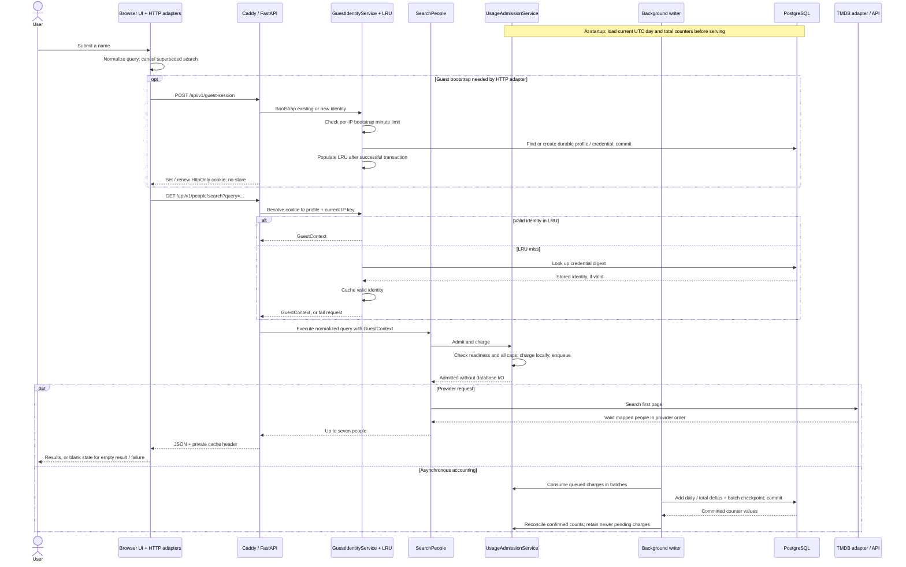

# F001 people-search architecture

Implemented architecture of `feature/brainstorming/F001-search-people` at
`d779554`, compared with `main` at `7a468ca`. This describes the code at that
snapshot, including the later guest-identity and asynchronous-accounting changes.

## Compact component diagram

## Detailed component overview

Arrows show runtime calls or data flow, rather than source-code imports. Dashed
arrows show background persistence, lifecycle work, or build-time generation.

The browser can satisfy a fresh cached search without reaching Caddy or the
backend. A successful backend response sets `Cache-Control: private` with the
configured lifetime, including for empty results. Bootstrap and error responses
use `no-store`. There is no backend search-result cache.

## Search request sequence

The sequence below assumes the browser needs a network response. The writer runs
independently and may flush while TMDB is still responding.

## Boundaries and operating constraints

- Both frontend and backend use ports and adapters. Application code imports
  domain types and defines ports; adapters implement those ports. The composition
  roots wire concrete adapters to use cases. React, FastAPI, HTTPX, SQLAlchemy and
  generated transport types stay outside the cores.
- The committed OpenAPI document is the frontend/backend contract. Generated
  TypeScript and Zod definitions are consumed only inside frontend API adapters.
- Guest credentials map to durable profile IDs. The cookie has a renewable
  365-day browser lifetime; server-side credentials have no expiry. Cached
  identities remain until LRU eviction or process restart.
- Search admission checks all nine global/guest/IP minute, daily and total caps
  in one event-loop turn. Daily and total usage equals confirmed database counts
  plus pending local charges. Minute counters stay in memory and reset on restart.
- Admission queues the charge before calling TMDB. Provider errors and cancelled
  searches retain that charge. No request-owned database transaction spans the
  provider call. A warm identity cache removes database reads from this path too.
- The writer retries the same writer ID and batch sequence after persistence
  failures. Counter updates and checkpoints commit together, making retries
  idempotent. A full backlog or unavailable writer rejects new admission.
- Strict quotas require one backend process/replica. A crash or a shutdown that
  exceeds the five-second drain can lose unflushed charges. The queue and minute
  limits are process-local.
- The browser adapter has an eight-second deadline; the HTTP response boundary
  has seven seconds; the TMDB adapter has five seconds. Bootstrap shares one
  in-flight operation across callers.
- Optional Logfire-compatible telemetry wraps services, HTTP and database
  boundaries. It is disabled by default and does not participate in quota
  decisions. Liveness and readiness routes make no TMDB calls; readiness checks
  writer capacity and database connectivity.

## Code map

| Responsibility | Source |
| --- | --- |
| Browser state and cancellation | [useSearchPeople.ts](../../frontend/src/adapters/inbound/ui/useSearchPeople.ts) |
| Frontend composition | [container.ts](../../frontend/src/bootstrap/container.ts) |
| API requests and guest bootstrap | [API adapters](../../frontend/src/adapters/outbound/api/) |
| Backend composition and lifecycle | [bootstrap.py](../../backend/src/lumiere/bootstrap.py) |
| HTTP endpoints and cache headers | [v1 routers](../../backend/src/lumiere/adapters/inbound/http/routers/v1/) |
| Search orchestration | [search_people.py](../../backend/src/lumiere/application/use_cases/search_people.py) |
| Durable identity and cache | [guest_identity.py](../../backend/src/lumiere/application/use_cases/guest_identity.py), [guest_cache.py](../../backend/src/lumiere/application/guest_cache.py) |
| Admission, queue and background writer | [usage_admission.py](../../backend/src/lumiere/application/use_cases/usage_admission.py) |
| Provider integration | [TMDB client](../../backend/src/lumiere/adapters/outbound/clients/tmdb_people/client.py) |
| Durable counters and batch checkpoints | [repositories.py](../../backend/src/lumiere/adapters/outbound/persistence/repositories.py), [models.py](../../backend/src/lumiere/adapters/outbound/persistence/models.py) |
| Same-origin serving and proxy | [Caddyfile](../../deploy/caddy/Caddyfile) |
| API contract | [openapi.json](../../openapi.json) |
