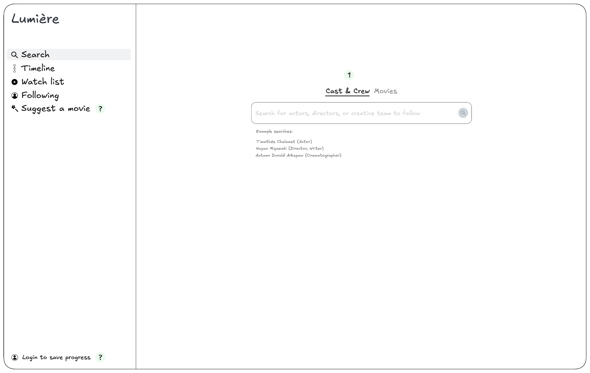
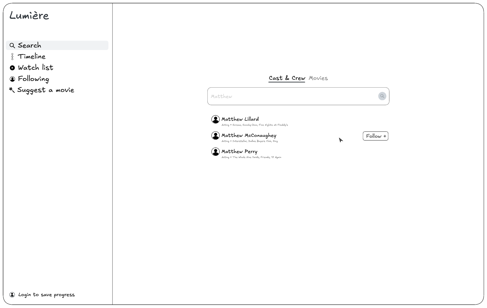
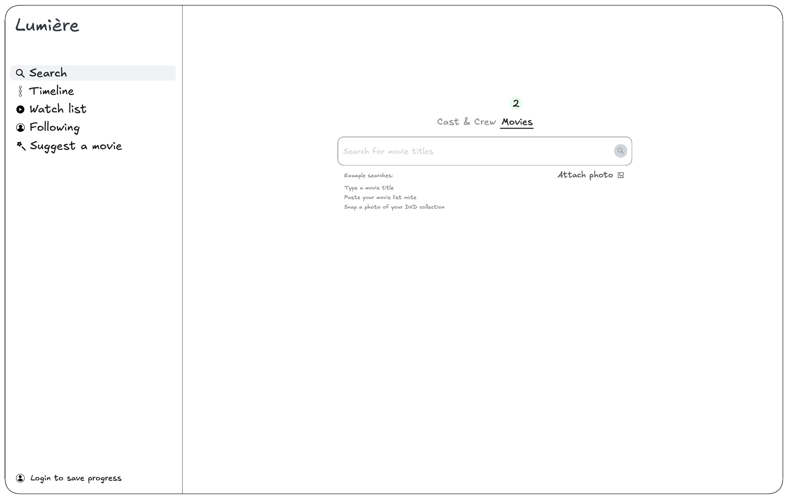
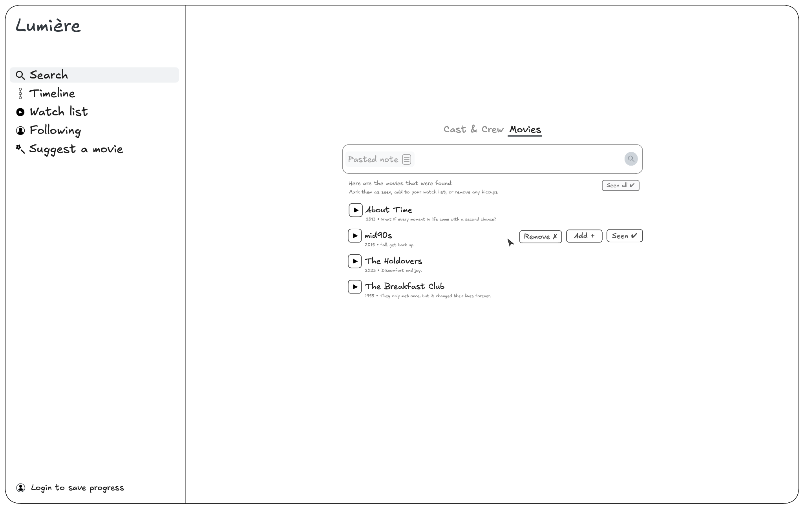
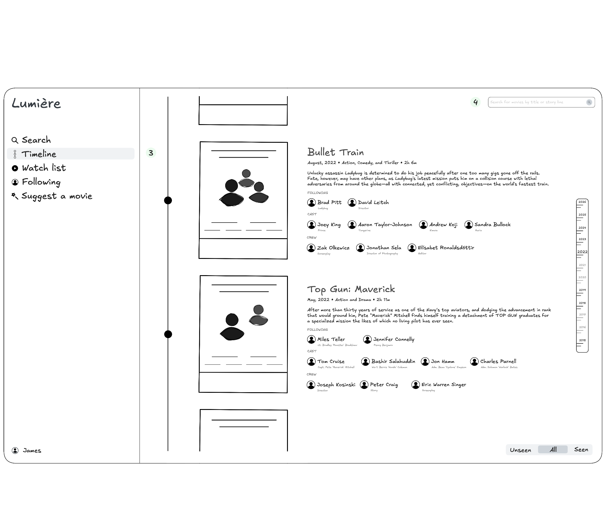
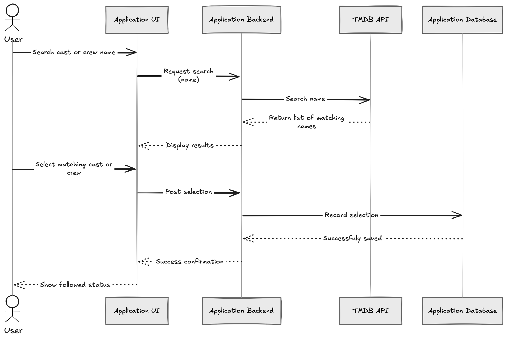
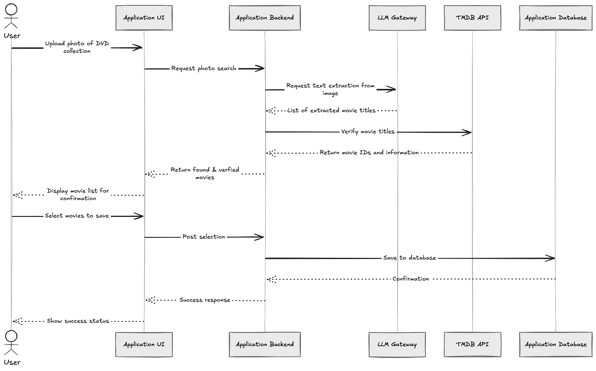

# Final Project Proposal

**ICS 603 · Fall 2026**  
**Iwo Wozniak**

## Project goal

A web app that helps people discover movies from their favorite actors, directors and creative team.

## Intended user and problem

This is for the people who while watching a movie connect with the actor and would like to see other movies with them. Or they like the way the movie came together and would like to see other movies by the same director. Or they enjoyed a movie's editing style, the way it was written, the score, or another creative aspect and would like to see more from that particular creative team member.

While there are a lot of movie tracking and discovery apps available today they're often catering to a wide audience, and focus on general use cases. Very few allow to follow actors and crew, and the ones that do focus on upcoming movies only. While it's possible to individually look up actors, directors and crew members, it's not possible to create your own personal timeline of their combined filmographies.

## Example input

Matthew McConaughey

## Sample input set

### Actor, director, and creative team names

Input / Output: Timothée Chalamet

Input / Output: Paul Thomas Anderson

Input / Output: Hayao Miyazaki

### Synthetic movie tracking note

Input: [search-note-input.md](sample-input-output/search-note-input.md)

Output: [search-note-output.md](sample-input-output/search-note-output.md)

### Synthetic DVD collection images

#### DVD collection photo 1

Input: [search-photo-1-input.png](sample-input-output/search-photo-1-input.png)

Output: [search-photo-1-output.md](sample-input-output/search-photo-1-output.md)

#### DVD collection photo 2

Input: [search-photo-2-input.png](sample-input-output/search-photo-2-input.png)

Output: [search-photo-2-output.md](sample-input-output/search-photo-2-output.md)

#### DVD collection photo 3

Input: [search-photo-3-input.png](sample-input-output/search-photo-3-input.png)

Output: [search-photo-3-output.md](sample-input-output/search-photo-3-output.md)

## Expected result and value

After a user follows a few of the cast & crew they’re interested in, they should be able to see a collated chronological timeline of movies from them. This combined timeline is currently not possible to achieve using existing tools or apps, and leaves the user individually browsing each of the cast & crew filmographies.

After a user imports their existing movie watch list or DVD collection photo, they should be able to filter their timeline based on the movie watch status. Viewing the timeline based on these unseen, all, seen filters is valuable because it allows for better discovery.

## Big-picture sketch

## Workflow or component sketch

**Following cast and crew**

**Importing a DVD collection photo**

## Data source and access

The app will depend on the TMDB API access, which requires registering for a key but is otherwise readily available.

## Up to three core features

1. Follow cast & crew
2. Import movies from a note or DVD collection photo
3. Suggest a movie

## LLM role

The model will be used to extract movie names from user’s pasted movie note and uploaded photo of their DVD collection.

The first model-connected increment is note extraction: a user pastes a movie note and receives a deduplicated list of extracted titles to review and edit. This increment returns titles only and does not use retrieval, the TMDB API, or a database. Photo extraction, movie metadata and matching, saved imports, timeline integration, and suggestions remain later increments.

Note extraction initially uses the gateway's `gpt-4.1-nano` model. Each note must contain non-whitespace text and be at most 20,000 characters before trimming. Each extraction allows one model request with a 30-second deadline and no automatic output-validation or provider retries; the user can retry explicitly. These per-request bounds do not implement a global gateway quota.

The model will also be used for the suggest a movie feature, where it will receive a list of cast & crew they follow, as well as the movies they’ve already seen, and be asked to generate 3 suggested movies to watch.

## Data use

The application will look up the user’s search inputs and LLM extraction outputs against the source TMDB API data. When a user follows a cast or crew, their filmography will further need to be looked up to be incorporated into the timeline.

## Saved records

The application will create a record for each of the cast & crew the user follows and the movies they’re tracking. The application also will create a user record that identifies which cast & crew the user is following, which movies they’ve seen, and which are in their watch list.

The cast & crew and movie records will be maintained in the application database as standalone records available to all users. The user records will specify the IDs of the cast & crew they follow as well as the movies they’ve seen or added to their watch list.

All of the above should be stored in a database and available after a restart.

## Searchable text

A timeline might contain many movies. In order to help with more focused movie discovery, the user might want to perform an exploratory timeline search using a storyline description they’re interested in. Their description will capture a meaning they intend to look for, in their own words, which might not directly match the stored movie descriptions based on keywords. Using a semantic search over those fields might return more helpful results.

## Human review

For the initial note-extraction increment, the page shows the extracted-title count, editable title fields, and initially selected keep checkboxes. Titles are not yet matched to movie records. The user can edit titles and deselect unwanted entries. These changes remain on the current page and are not saved or added to a watch list or timeline; reloading clears the list. A successful extraction replaces the previous review list, including clearing it when no titles are found. Sample search is separate and leaves the review list intact.

When the user searches for cast & crew to follow, their search may return multiple results. The user will need to confirm their choice from the list of returned results. The results list will contain additional information such as the portrait, role, and a few select movies, to help the user identify the correct result.

When the user uploads their DVD collection photo, the application will present its best guess of the movies recognized based on what the LLM returned, and what was matched via the TMDB API. The list of movies will contain additional information such as the movie poster thumbnail, the release year, and the tagline to help users identify the correct results.

## One failure case

If note extraction fails, the user should see a helpful message and be able to retry. Their pasted note and any previous title edits and selections should remain available on the page. While an extraction is pending, the page announces loading and prevents duplicate submissions.

If the LLM image extraction fails, the user should see a helpful message, and have the ability to retry. Their uploaded image should remain available. Their previous selections should be unaffected.

## Three acceptance criteria (include at least one failure case)

1. Given the user follows Bashir Salahuddin and Emilia Clarke, when they navigate to their timeline, then they should see movies from both in chronological order.

2. Given the user successfully imports movies from a photo of their Harry Potter DVD collection, when they nativate to their timeline, then they’re able to see the Harry Potter movies interpolated in the timeline, even though they don’t follow any of the cast & crew from those movies.

3. Given that the app server crashes and is restarted, when the user returns to the app in their browser, then their session should be resumed without having to log in again.

## Outside version one

- Mobile viewport size styling
- OAuth or email based authentication
- Weekly email notification about the upcoming releases from user’s followed
- Information about where the user can watch a particular movie
- Filtering user’s timeline view by identified genres or themes
- Suggestions for new cast & crew to follow based on movies they’ve seen
- Shows support

## Open questions

### Feasibility uncertainty

- Will the LLM be able to extract movie titles from notes and photos, and how well will the extracted titles be directly searchable in the TMDB API? Will there typically only be one confident match?

### Decisions need to be made

- Should the suggest a movie feature take any additional user input to influence the generation?
- How should V1 of the app handle user accounts?

### Technical details

- Which model performs best for the text from image extraction?
- How to practically and effectively enforce global LLM Gateway limits within the app to mitigate the risk of excessive usage?
- How to adhere to TMDB API rate limits?
- How to implement semantic storyline search?

For the feasibility uncertainty, I will need to investigate whether the movie title text returned by the model typically results in an exact or partial match in the TMDB API. This will inform me whether I can specify the interface to not show the rare partial match at all, or if the app needs to display partial matches. Having to display partial matches will make the UI and the interaction more complicated.

## Next investigation

**How well can a model extract titles from DVD collection images?**

I will prepare a set of a few synthetic and organic DVD collection photos. Manually annotate them with all the movie titles present, with the labels matching how the movie title appears in TMDB API. Identify the vision models available via the LLM Gateway. Prepare a matrix of tests where each photo in the set is submitted to each of the models, using a few different prompt, temperature, top-p, and reasoning settings, and score how well the returned results match the annotations, how consistent the results are across multiple attempts, and what the costs and latency are for each.

If there isn’t a model that can consistently and accurately identify movies in photos up to a certain useful threshold, the photo feature might need to be postponed until a satisfactory approach is available.

If the model is able to extract movies from photos reliably, this might open up other future use cases in the app, such as identifying movies from user screenshots of their digital collections.
