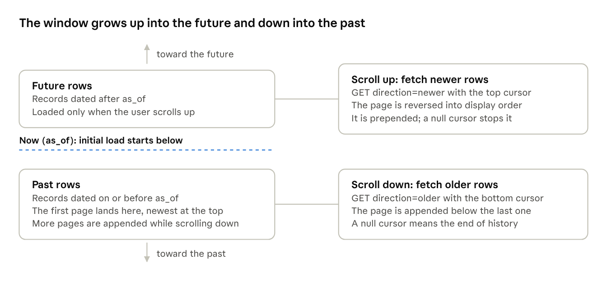

# Timeline Pagination: High-Level Design Guide

This is a generic sample, that directionally aligns with our view of our timeline feature, describing the high-level design of such a feature.

## Summary

The timeline is one newest-first list served as a sliding window: future records sit above the present, past records below it, and the server hands out cursors that the client uses to load more in either direction. Pages are never numbered.

- **Keyset pagination.** Order by a unique key, `(occurred_at, id)`, and continue from a cursor instead of an offset. Cost stays flat, and inserts elsewhere in the list don't shift the next page.
- **Start at the present.** The first request anchors at the server's "now" and returns the past side only. A cursor lets the user scroll up into the future.
- **Two directions, one index.** `older` requests walk down the list and `newer` requests walk up, both served by the same index.
- **Memory-only position.** Loaded pages and the scroll anchor live above the router, so route changes keep them and a page reload discards them, which returns the user to the present.
- **Refresh by position.** When the data may have changed, the client reloads a window centered on the point in time the user was viewing, so the view stays roughly in place even if the exact record is gone.

## Requirements and assumptions

The design has to deliver eight behaviors:

- Every record has a non-null timestamp (`occurred_at`). Most are in the past and some are in the future.
- The list is newest-first: scrolling down moves into the past, scrolling up moves toward the future.
- A fresh load starts at the present with nothing above the viewport. Future records load only if the user scrolls up.
- While the app stays loaded, leaving the timeline route and returning puts the user back at the same spot.
- Actions elsewhere in the app can change the timeline, so on return the data may need a refresh even though the position stays the same.
- If the record the user was viewing, or records near it, disappear during a refresh, the view stays at roughly the same point in time.
- Reloading the page starts over at the present.
- No numbered pages and no total count are required.

Assumed stack: async FastAPI with Pydantic, SQLAlchemy (async) on Postgres (Neon), and an Expo / React Native Web client. Records belong to a scope such as a user or tenant, and any filters are fixed for a given timeline view.

## Core concepts

Pagination is anchored to a record, not a position: a cursor says "continue from this record", so inserts and deletes elsewhere in the list don't change what comes next.

- **Unique sort key.** Order by `(occurred_at DESC, id DESC)`. The id breaks ties between identical timestamps, which makes the order total and deterministic.
- **Keyset cursor.** A cursor holds the sort-key values of the last row the client received. The server turns it into a row-value comparison such as `(occurred_at, id) < (:ts, :id)`, which Postgres satisfies with an index seek. Page 1 and page 5,000 cost about the same.
- **Opaque cursor.** The server encodes the values as JSON in URL-safe base64 with an HMAC signature. The client treats the string as a token and sends it back unchanged, so the sort keys can change later without breaking clients and tampered cursors are rejected.
- **One extra row.** The server fetches `limit + 1` rows. If the extra row exists, more records remain in that direction. It is dropped, and the cursor is built from the last row actually returned. No count query is needed.

## Initial load: starting at the present

The first request, sent with no cursor, anchors at the server's current time and returns only the past side.

1. The server reads `now` once from the database clock, not the client's, which can be skewed, and uses that one value for every predicate in the request.
2. It selects rows with `occurred_at <= now`, newest first, `limit + 1` of them. A row at exactly `now` counts as past, so the split between past and future has no overlap and no gap.
3. It returns the page, `as_of` (the `now` it used), and two cursors. `older_cursor` is null if the past side is exhausted. `newer_cursor` is a boundary cursor meaning "everything strictly after `as_of`", and is null when a cheap existence probe finds no future records.
4. The client renders the page with the viewport at the top. Nothing sits above the first row, so there is no scroll correction on first paint. If `newer_cursor` is set, a start-of-list trigger lets the user scroll up into the future.

An eager variant returns a small future window (say 10 rows) in the first response and scrolls the "Now" boundary into view on mount. It saves a round trip for users who usually look ahead, but it needs an initial scroll correction, so the lazy version above is the default.

After this request `as_of` has one job: the client uses it to place the "Now" divider. Every later request is anchored to a cursor, so the passage of time doesn't affect paging.

## API contract

One endpoint, `GET /timeline`, serves every case. The direction is named `older` or `newer` because "before" and "after" are ambiguous in a newest-first list.

| Parameter | Meaning |
| --- | --- |
| `limit` | Page size. Default 20, capped on the server (for example at 100). |
| `cursor` | Opaque token from an earlier response, used with `direction` to page. Omitted on the initial load. |
| `direction` | `older` (down, toward the past) or `newer` (up, toward the future). Required when `cursor` is present. |
| `anchor_at`, `anchor_id` | A position to center the window on: the timestamp, and optionally the id, of the record the user was viewing. Used to refresh in place, and sent instead of `cursor`. |

The response is a Pydantic model, `TimelinePage`:

```json
{
  "items": [ ],
  "older_cursor": "eyJ2IjoxLC4uLn0.sig",
  "newer_cursor": "eyJ2IjoxLC4uLn0.sig",
  "as_of": "2026-11-24T15:00:00.123456Z"
}
```

- `items` are always in display order (newest first), including for `newer` requests.
- Each cursor is built from the page's own last row (`older_cursor`) or first row (`newer_cursor`). A null cursor means nothing remains in that direction, and the client stops requesting.
- The client reads the top cursor from the first loaded page and the bottom cursor from the last loaded page. The opposite cursor on any other page is never used, which prevents mixing up window edges.
- `as_of` is present on the initial load and on anchored requests.
- `anchor_index` is present only on anchored requests. It is the index of the first item at or older than the anchor, which is the anchor record itself if it still exists. It is null if no such item remains.
- A request carries either a `cursor` or an anchor, never both.
- A cursor that is invalid, tampered with, or issued for different filters returns a 400. The client then falls back to an anchored refresh at its saved position, or to the initial load if it has none.

## Navigating in either direction

Every request after the first is a seek from a cursor or an anchor, and both directions use the same index, scanned in opposite directions.

| Request | Rows selected | Scan order | Result |
| --- | --- | --- | --- |
| Initial (no cursor) | `occurred_at <= now` | Newest first | Past page, `as_of`, both cursors |
| `older` from a cursor | `(occurred_at, id) < cursor` | Newest first | Next page down. `older_cursor` is null at the end of history. |
| `newer` from a cursor | `(occurred_at, id) > cursor` | Oldest first, then reversed | Next page up, in display order. `newer_cursor` is null at the farthest future record. |
| Anchored (`anchor_at`) | Older side: `(occurred_at, id) <= anchor`. Newer side: `(occurred_at, id) > anchor`. | Older side newest first. Newer side oldest first, then reversed. | One page centered on the anchor, with `anchor_index`, `as_of` and both cursors. |

- **Scrolling down.** When the bottom trigger nears, the client sends `direction=older` with the last page's `older_cursor` and appends the rows.
- **Scrolling up.** When the top trigger nears, it sends `direction=newer` with the first page's `newer_cursor` and prepends the rows. The oldest-first scan makes `LIMIT` keep the rows closest to the cursor rather than the farthest-out ones.
- **Request discipline.** At most one request per direction is in flight, and a null cursor removes that direction's trigger.
- **Stable viewport.** Prepending must not move what the user is looking at: the same visible record stays in place while rows are inserted above it.



The top edge fetches newer rows, the bottom edge fetches older ones, and the Now line stays at the as\_of of the latest load or refresh.

## Refreshing while keeping position

When the timeline may have changed, the client refreshes by reloading a window centered on the position the user was viewing. It neither refetches every cached page nor jumps back to the present.

Actions elsewhere in the app, such as editing, creating or deleting records on other routes, can change the timeline while its screen is out of sight, yet the user still expects to return to the same spot. The saved scroll anchor therefore records a position in time: the `occurred_at` and `id` of the first visible record, plus its pixel offset. It is not a reference to a row that must still exist.

| What changed | Client response |
| --- | --- |
| A change the app made and can describe exactly (edit, delete, create) | Patch the cached pages in place. If the patch removes the saved anchor record, move the anchor to its neighbor in the cache. |
| A change the client can't apply exactly (bulk actions, server-side effects, a push message), or data older than a freshness window (for example a few minutes) | Mark the timeline dirty. |
| Nothing changed | Show the cached window as it is. |

When the user returns to a dirty timeline:

1. Render the cached window immediately at the saved position.
2. Send an anchored request with the saved `anchor_at` and `anchor_id`. The server returns up to `limit` rows at or older than the anchor, up to `limit` rows newer than it, and `anchor_index`.
3. Replace the cached pages with that single page and restore the scroll in the same layout pass. If the row at `anchor_index` is the saved anchor record, restore the saved offset. If not, the record is gone, so align that row (the next older record) to the top of the viewport.
4. If the user has already scrolled since returning, use the record currently at the top of the viewport as the anchor instead of the saved one.
5. Recompute the "Now" divider from the new `as_of`.

Because the anchor is a value and not a row, it makes no difference if the record the user was viewing, or several records around it, were deleted. The lookup lands on the nearest remaining records, the viewport stays at roughly the same point in time, and records added nearby appear in place.

The initial load is the special case of this request where the anchor is `now` and the newer side is left empty to load lazily.

## Backend: FastAPI, SQLAlchemy and Postgres

The backend is four thin layers, and the only real logic sits in the query builder and the cursor codec.

- **Route (FastAPI).** Validates `limit`, `cursor` and `direction`, and returns the Pydantic `TimelinePage`. The item schema, the page envelope and the cursor payload (`v`, `ts`, `id`, filter fingerprint) are all Pydantic models.
- **Cursor codec.** Encodes JSON to URL-safe base64 with an HMAC signature. It keeps full microsecond timestamps, carries a version number, and raises a 400 on anything invalid.
- **Query builder (SQLAlchemy 2.0, async session).** One function takes the cursor, direction, limit and scope, and builds the `select()`. It uses `tuple_(Record.occurred_at, Record.id)` for the row-value comparison, flips the order for `newer`, and asks for `limit + 1` rows.
- **Database.** `occurred_at` is `timestamptz NOT NULL`, with one composite index such as `(scope_id, occurred_at DESC, id DESC)`. Postgres can scan it backward, so the `newer` query uses the same index.

The two paging queries differ only in comparison and order:

```sql
-- older
SELECT ... FROM records
WHERE scope_id = :scope AND (occurred_at, id) < (:ts, :id)
ORDER BY occurred_at DESC, id DESC
LIMIT :limit_plus_one;

-- newer (the handler reverses the rows)
SELECT ... FROM records
WHERE scope_id = :scope AND (occurred_at, id) > (:ts, :id)
ORDER BY occurred_at ASC, id ASC
LIMIT :limit_plus_one;
```

The initial load is the `older` query with `occurred_at <= :now` and no row-value predicate, plus an existence probe for rows after `:now`.

An anchored request runs both sides in one round trip: the `older` query with an inclusive `<=` comparison against the anchor, and the `newer` query with `>`, each asking for `limit + 1` rows. The handler reverses the newer side and returns it above the older side. `anchor_index` is the number of newer-side rows kept, or null if the older side is empty. The route accepts either a cursor or an anchor, never both.

If items need data from other tables, paginate the main table first (a subquery or CTE carrying the `LIMIT`) and join afterward. Many-to-one lookups are cheap, and one-to-many joins multiply rows, so they must come after the limit. Don't sort by a joined table's column: copy the sort key onto the main table instead.

## Client: Expo / React Native Web

Position memory works because the data and the scroll anchor live above the screen that shows the timeline, and nothing is persisted across reloads.

- **Data layer.** One app-level query cache holds the pages. TanStack Query's `useInfiniteQuery` fits, with the client mounted at the app root. The first page param is "no cursor", `getNextPageParam` reads the last page's `older_cursor`, and `getPreviousPageParam` reads the first page's `newer_cursor`. Setting `staleTime` and `gcTime` to `Infinity` means leaving the screen never discards pages or refetches them automatically, which matters because an automatic refetch of an infinite query replays every cached page. A refresh is explicit: it writes the anchored page into the cache as its only page (`setQueryData` in TanStack Query). The query key includes scope and filters so a cursor never meets a different query.
- **List.** A virtualized list with one trigger at each end: end-reached fetches `older`, start-reached fetches `newer`. Rows are keyed by record id. A "Now" divider is derived on the client from the latest `as_of`: rows after it sit above the divider and the rest below.
- **Prepending.** This is the hardest client problem. The list must keep the visible rows in place when rows are inserted above them. React Native's list components expose `onStartReached` and `maintainVisibleContentPosition`, but support on react-native-web varies by version and by list library (FlatList, FlashList, LegendList), so verify it before committing. The fallback is to measure content height before and after the insert and adjust the scroll offset by the difference.
- **Remembering position.** The cache keeps the data, and an in-memory record keeps the scroll anchor: the `occurred_at` and id of the first visible record plus its offset from the top of the viewport. It is saved when the screen blurs or unmounts and restored on mount by scrolling to that record's index. An anchor record is more reliable than a raw pixel offset because row heights change as content loads. Expo Router stacks and tabs often keep screens mounted, which preserves scroll for free, but the design shouldn't depend on it.
- **Reload.** Everything above is memory-only. Don't persist the timeline cache or the anchor (no `persistQueryClient`, no AsyncStorage or `localStorage`), so a reload runs the initial load and lands on the present.
- **Changes and refresh.** Mutations the app can describe patch the cache. Anything else marks the timeline dirty, and the next return runs the anchored refresh described above, which keeps the position by time. Logout clears the cache.

## Edge cases and risks

Most risks come from the list changing underneath a long-lived window, or from tie-breaking and precision details.

- **Identical timestamps.** The `id` tie-breaker is mandatory. Without it, rows are skipped or repeated at page boundaries.
- **The present boundary.** A row at exactly `as_of` counts as past. Apply the same rule in every query.
- **Late inserts.** Records added after the load with timestamps inside the loaded range, including future records dated between the loaded top and now, appear only at the next refresh. The triggers are the dirty flag, the freshness window, or a push message.
- **Deleted cursor and anchor rows.** Harmless, because cursors and anchors compare values and never look up the row. A deleted anchor record resolves to the next older record that remains.
- **Emptied neighborhood.** If no record at or older than the anchor remains, `anchor_index` and `older_cursor` are null. The client aligns to the last returned row, or shows the empty state if the list is empty.
- **Stale or mismatched cursors.** A cursor from an old sort, filter or version is rejected with a 400, and the client falls back to an anchored refresh at its saved position.
- **Timestamp precision.** Keep microseconds in cursors, and send `anchor_at` back as the exact string the server returned. Parsing it into a JavaScript `Date` truncates to milliseconds and can skip or repeat rows that share a millisecond.
- **Memory growth.** A long session accumulates pages. Virtualize rendering and optionally cap cached pages (for example with `maxPages`). Because every page carries both cursors, trimmed pages can be refetched.
- **Neon connection pooling.** The pooled endpoint sits behind PgBouncer. Check Neon's current guidance for async SQLAlchemy and asyncpg settings, such as prepared-statement handling, before production.
- **No totals.** Keyset pagination has no page count, so a scrollbar reflects only the loaded rows.

## Possible extensions

The design extends in four directions without changing the core cursor model.

- **Jump to a section.** Reuse the anchored request: set `anchor_at` to the section's boundary and replace the window with the response. Add a cheap endpoint that returns section counts.
- **Live updates.** New records can arrive by polling `direction=newer` from the top cursor or through a push channel. They are prepended with the same scroll-preserving logic, or the push message simply marks the timeline dirty so the next return refreshes it.
- **Filters and search.** Fold a filter fingerprint into the cursor and the cache key. Precompute section counts only if the UI needs them.
- **Other sort keys.** A different ordering needs its own matching index and a cursor that carries that key plus the id.
