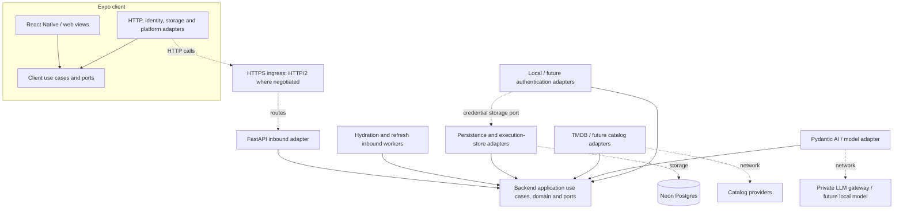

# Application architecture

Date: 2026-11-09

Status: Approved by the project owner on 2026-11-09

Scope: Starting architecture for the whole application; individual features will be designed separately.

## Intent and document authority

The application helps people discover movies through actors, directors, and other creative contributors. A user follows people, explores their combined filmographies chronologically, tracks watched movies and a watch list, imports movie titles from notes or photos, and receives movie suggestions. Semantic storyline search supports exploring the user's timeline in their own words.

This document establishes the boundaries, technology direction, data ownership, and operational rules that later feature designs must preserve. It is not an implementation plan or a complete feature specification. Ports described here are responsibilities, not final interface signatures.

The [proposal](../../proposal/proposal.md), its five [wireframes](../../proposal/wireframes/), and two [workflows](../../proposal/workflows/) supply the product context. This design supersedes the proposal's development ordering and narrow note-extraction increment: **the first increment is searching for people and following them**. Old note limits and model choices are not architecture commitments; the relevant feature sessions will revisit them.

Decisions labeled **agreed** come from the architecture discussion. Decisions labeled **proposed** identify architectural calls made while drafting; these were accepted with the document's approval on 2026-11-09. Both form the approved architecture baseline. Items explicitly deferred or described as candidates remain open for later feature designs. Individual feature planning and implementation remain separate work.

## Goals, constraints, and exclusions

The architecture must support:

- Ports and adapters in both backend and frontend, with business behavior independent of frameworks, providers, and persistence implementations.
- An async application, Pydantic boundary validation, Pydantic AI through a private LLM gateway, Pydantic Logfire observability, and Neon Postgres storage.
- Expo, React Native, and React Native for web from the outset, with native iOS and Android delivery following initial web functionality.
- Replaceable and supplementary catalog providers, initially TMDB; reusable local copies of retrieved data and background refreshes.
- Replaceable authentication, initially an app-owned username/password provider with hashed credentials in the database.
- Docker deployments and client-to-API HTTP/2 where available.
- Server-enforced guest access, rate limits, and daily and cumulative usage budgets.

Avoid a design that couples application rules to TMDB IDs or response shapes, ORM models, a jobs table, an authentication vendor, or browser-only APIs. Also avoid unnecessary services, a generic workflow engine, premature microservices, and building future features before their own design sessions.

The proposal's exclusions remain: television shows, streaming availability, weekly emails, discovery of additional people to follow, and OAuth/email registration in the first version. Selecting a universal client does not require native releases or polished mobile layouts in the first web increment. The architecture anticipates these platforms without setting their delivery dates.

## Product map

| Capability | Intended behavior | Architectural implication |
| --- | --- | --- |
| People discovery and following | Search by name, identify a person using contextual information, follow/unfollow, and inspect followed people. | Provider search, stable person identities, profile-owned follows, and initial filmography hydration. |
| Movie discovery and imports | Search a title or extract candidates from a pasted note or attached photos; review matches before saving watched status or watch-list membership. | Extraction and catalog matching are separate operations; model output cannot directly mutate the library. |
| Personal library | Persist watched movies and watch-list membership. | User-owned state references shared movie identities and survives catalog refreshes. |
| Timeline | Combine followed people's movies and explicitly tracked movies, deduplicate, order chronologically, and filter by watched status. | An application query over catalog data and user state; incomplete hydration is observable. |
| Semantic storyline search | Search within the user's timeline by meaning. | Replaceable semantic retrieval and embedding capabilities; enforce timeline membership during retrieval. |
| Movie suggestions | Suggest movies using follows and watched history; later feature design settles additional input and presentation. | Recommendation output is validated and resolved to catalog identities before it can be saved. |

These are feature boundaries, not separate services. Exact filtering, ranking, matching review, pagination, and interaction details belong to later designs.

## Approaches considered

### Client architecture

**Selected: Expo + React Native + React Native for web.** Mobile applications are likely soon after initial web functionality, so sharing the client foundation now is worth the platform considerations. Platform-specific adapters and views remain possible. Expo documents both universal components and platform-specific implementations in its [web guide](https://docs.expo.dev/workflow/web/).

The alternative was React/TypeScript with Vite for the web and a later mobile client sharing suitable core logic. It simplifies an exclusively web-first start but offers less immediate UI reuse. It was not selected because mobile delivery is relatively near-term.

### Application deployment

**Proposed: one modular backend codebase with an HTTP API and separately run worker processes.** It preserves feature and adapter boundaries while allowing direct in-process application calls and a shared transaction boundary. A single deployment unit for the API is sufficient initially. Separately deployed feature services add coordination and operational work without an identified need.

### Refresh execution

**Selected: reconstruct due refresh work from catalog records, process disposable in-memory batches, and persist execution/retry bookkeeping through a port.** Last successful fetch timestamps plus application freshness policies identify due work. One refresh worker is sufficient initially. Initial hydration has a separate worker so refresh work cannot delay it.

Alternatives were a Postgres-backed task library such as Procrastinate, or Redis with an async task framework such as Taskiq. They offer more general dispatch machinery but introduce library or infrastructure coupling that current refresh requirements do not justify. Neither is selected. The selected contracts must permit adopting either later.

## Technology direction

| Area | Starting choice | Decision basis |
| --- | --- | --- |
| Backend runtime | Python 3.13+ and uv | Existing repository baseline, retained as a proposal. |
| HTTP adapter | FastAPI with an ASGI server, initially Uvicorn | Proposed; integrates async handlers, Pydantic, and OpenAPI. |
| Backend boundary models | Pydantic | Agreed; API, configuration, provider and model-output validation. |
| AI adapter | Pydantic AI through the private gateway | Agreed; model choice deferred. |
| Persistent storage | Neon Postgres | Agreed initial deployment; persistence ports remain implementation-independent. |
| Database adapter and migrations | Async SQLAlchemy with psycopg 3; Alembic | Proposed; SQL/ORM and migrations remain outside the core. |
| Client | TypeScript, Expo, React Native, React Native for web; Expo Router | Universal foundation agreed; TypeScript and router are proposed supporting choices. |
| API contract | Versioned JSON HTTP API described by OpenAPI | Proposed; generate transport types and validate external data at runtime. |
| Client boundary validation | Zod or generated equivalent from the API schema | Proposed Zod; the code generation tool is left to implementation. |
| Password storage | Argon2id using a maintained hashing library | Proposed; tune parameters during authentication implementation. |
| Observability | Pydantic Logfire | Agreed; instrumentation lives at composition and adapter boundaries. |
| HTTPS ingress | Caddy, or an equivalent hosting ingress | Proposed; serve the web build and route API requests under one origin. |
| Refresh/hydration execution | Application workers; initial Postgres execution-store adapter | Agreed direction; no queue service or third-party job framework initially. |
| Semantic search | Retrieval and embedding ports; technology deferred | Agreed; Postgres with pgvector is a candidate, not a selected dependency. |

[FastAPI](https://fastapi.tiangolo.com/features/) provides the proposed API foundation; [SQLAlchemy's async API](https://docs.sqlalchemy.org/en/21/orm/extensions/asyncio.html) and [Alembic](https://alembic.sqlalchemy.org/en/latest/) support the proposed persistence adapter. Pin compatible versions in the eventual implementation rather than treating this document as a version lockfile.

## System shape and dependency direction

Solid arrows point toward the code's owned contracts and application behavior; dotted arrows show runtime transport. Logfire instrumentation surrounds HTTP requests, use cases, workers, database operations, and external calls; the domain does not depend on Logfire.

**Backend:** the domain contains app-owned entities, value objects, and invariants. Application use cases coordinate domain behavior and define required outbound ports. HTTP endpoints and workers are inbound adapters. Persistence, catalog services, authentication, inference, and execution storage are outbound adapters. A composition root constructs concrete dependencies. Core code never imports FastAPI, SQLAlchemy, TMDB clients, Pydantic AI clients, or job-store implementations.

Pydantic validates boundary DTOs; domain objects may be plain Python types/dataclasses. Transport models, provider payloads, ORM records, and domain entities are separate representations. Translate once at the appropriate boundary rather than passing raw dictionaries through the system.

**Client:** views and route handlers invoke client use cases. Those use cases depend on client-owned ports for the application API, identity/session handling, and platform capabilities such as photo selection. HTTP adapters translate API DTOs into client models. React hooks can connect view lifecycles to use cases, but domain/application code contains no React hooks, DOM, Expo, fetch, cookie, or SecureStore dependencies. Platform adapters provide those details.

Keep client rules focused on interaction and presentation. Authorization, quota enforcement, follows, library changes, and catalog identity decisions remain authoritative on the server. Share client behavior across platforms without duplicating the backend domain as a second authority.

## Backend modules and port responsibilities

Organize around identity/access, catalog, following/library, discovery/timeline, AI operations, and background execution. Modules expose application interfaces and do not reach into one another's adapter internals. Extract shared primitives narrowly rather than making a large universal service layer.

| Port responsibility | Owned meaning | Initial implementation |
| --- | --- | --- |
| Catalog discovery | Search people/movies and retrieve provider information in normalized app-owned DTOs, with provenance. | TMDB adapter. |
| Catalog persistence and query | Store/retrieve local entities, source mappings, credits, reusable retrieval results, and due refresh candidates. | Async Postgres adapter. |
| User state persistence | Follows, library facts, and transactionally enforced profile limits. | Async Postgres adapter. |
| Authentication | Validate a supported credential/proof and return a provider-neutral identity. | Local username/password adapter. |
| Identity/session persistence | Map provider subjects to app users and resolve/revoke sessions. | Postgres adapter. |
| Usage admission/accounting | Atomically check scopes, reserve allowance, record actual usage, and settle/release reservations. | Postgres adapter. |
| Work dispatch/execution store | Request hydration, obtain eligible work, record completion/failure, and control duplicate execution. | Postgres bookkeeping adapter plus disposable in-memory batches. |
| Movie title extraction / suggestions | Perform bounded AI operations with typed results. | Pydantic AI gateway adapter. |
| Semantic retrieval / embeddings | Retrieve by meaning and produce compatible vectors without exposing a vector-store API to the core. | Deferred. |

A unit-of-work/transaction capability supports related local changes without exposing SQLAlchemy sessions. The execution-store contract describes task identity, eligibility, attempts, retry timing, completion, and ownership semantics; it does **not** expose table names, SQL queries, database row objects, or an in-memory queue to callers. A later queue-backed adapter must preserve those semantics. Cross-store atomic dispatch may require an outbox inside adapters; the application still expresses the same business operation.

## Catalog identities, local data, and provenance

**Agreed:** people and movies use app-owned identifiers. External identifiers are mappings keyed by provider and entity type. Follows, library facts, and timeline results reference internal identities. Actors and crew are people with credits that can contain multiple roles/jobs; they are not separate incompatible identity types.

Keep these concerns distinct:

- Shared normalized people, movies, and credits used by application queries.
- Provider source mappings and locally retained source data sufficient for remapping and refresh, including provenance and successful fetch timestamps.
- User-owned follows, watched status, and watch-list membership.
- Job execution/retry state and usage accounting.

**Proposed:** use internal UUIDs and keep watched status and watch-list membership as independent facts until their feature design settles transitions. A source refresh never erases user-owned state. Missing or removed provider entries can be marked unavailable while retaining identities and references.

Providers return normalized DTOs and optional source-specific data retained inside the catalog adapter/storage boundary. An application-level selection/merge policy chooses sources and field precedence; the domain does not know that TMDB is preferred. Start with TMDB as the only configured source. Adding another provider requires mapping and policy work, not a rewrite of following or timeline behavior.

Do not merge people or movies solely by display name/title. Cross-provider reconciliation is a later catalog design concern, using trustworthy identifiers or explicit resolution. Provider independence protects the core; it does not eliminate the need to map existing records when replacing a source.

### Local-first retrieval

Use suitable previously retrieved data before making provider calls. Read available local catalog data while arranging due refreshes in the background. Missing information can trigger an on-demand lookup or hydration, depending on the use case. Preserve useful stale data during refresh failures and expose incomplete hydration distinctly from a genuine empty filmography.

An entity table alone is not a complete search index of an external provider. Cache reusable search results with their query, page, language/region, provider, and fetch time where relevant; on a cache miss, search the provider and retain normalized results. Do not claim a local subset represents every matching person/movie. Search cache sizing and retention are feature-level policies.

### Freshness

Each independently retrieved data unit stores its last **successful provider fetch** timestamp. This differs from a generic database `updated_at`, which can change for unrelated reasons. Separate data categories, such as person details and filmography, can have distinct fetched records/timestamps where they need different refresh frequencies.

Refresh intervals and priorities live in application policies/configuration, not scheduling columns on catalog records. Policies can consider data category, future/recent release dates, and active use. Candidate queries may optimize this policy in persistence, but application code owns its meaning. Exact intervals remain for catalog feature design.

## Hydration and refresh workers

**Agreed:** initial hydration is a user-facing hot path; routine refresh is background maintenance. **Proposed:** operate separate hydration and refresh worker processes from the same backend image. Start with one active process for each role and one record at a time in the refresh worker. API processes remain separate and responsive.

Following a person commits the follow and a hydration intent together when required data is missing. Already complete local data can be used immediately. Hydration work is coalesced by target/data category; multiple users following the same person need not cause equivalent provider calls. The API reports followed state independently from hydration readiness, and clients can poll bounded status/timeline queries while work runs. Exact loading presentation is left to feature design.

The refresh loop reads a bounded batch of eligible catalog records, prioritizes them using the refresh policy, processes them sequentially, and repeats after a configurable interval. The batch does not need persistence: after restart, last successful fetch timestamps reconstruct remaining work. The worker does not refresh the entire catalog on every scan; candidate selection and indexes belong to the persistence adapter.

Persist execution bookkeeping separately through the work port: target/kind, execution status, number of failures since the last success, retry eligibility, and minimal diagnostic information. A failed fetch leaves the catalog success timestamp unchanged and updates job backoff. Successful execution atomically saves catalog changes and fetch timestamps, resets the failure count, and records completion where they share storage. Hydration and refresh coordinate ownership for the same target so they do not concurrently overwrite each other's work.

Network requests occur outside database transactions. Provider results do not need staging storage before commit. A crash between fetch and commit can repeat the call, subject to the same budget checks; adapter writes are idempotent. Work ownership is reclaimable after a crash rather than leaving a permanent running state. Initial deployment prevents overlapping worker instances for the same role; expanding concurrency requires claims/leases with semantics preserved by the work port.

Use bounded exponential backoff with jitter for retryable failures. Permanent failures remain visible without a hot retry loop. Exhausted budgets pause/defer work until allowance becomes available; they do not mark data fresh. Urgent hydration must also get priority in shared provider concurrency/rate allocations, so a dedicated process alone does not imply unrestricted provider capacity.

## Identity, authentication, and sessions

**Agreed:** guests can follow at most three people. Authenticated users have no follow-count cap, while all users remain subject to rate and usage controls. The server checks the guest cap atomically with the follow change; concurrent requests cannot exceed it.

**Proposed:** a stable internal profile ID owns user state. Registration upgrades the current guest profile to an account and preserves its follows. Signing into an existing different account must not silently merge data or identities; that transition's UX and merge rules belong to the authentication feature design.

Authentication returns an identity such as issuer/provider plus subject, mapped to an internal account. Identity-provider subjects, usernames, emails, session secrets, and internal profile IDs are distinct. Provider-specific login and registration adapters can change without affecting catalog, following, timeline, or quota rules. External sign-in can require different adapter-level redirects/screens or an account migration; swapping providers does not promise identical credential flows.

The initial local provider stores username credentials separately from application user state. **Proposed:** Argon2id hashes with per-password salts generated by a maintained library, following [OWASP password-storage guidance](https://cheatsheetseries.owasp.org/cheatsheets/Password_Storage_Cheat_Sheet.html). Store the encoded algorithm/parameter/hash representation, support parameter upgrades, and run expensive hashing in a bounded execution pool rather than blocking the async event loop. Passwords never enter logs, traces, or application-facing identity results. Login attempts are throttled independently of paid-feature quotas.

**Proposed session transport:** opaque, revocable app sessions backed by persistent storage. On web, use secure HttpOnly same-site session cookies, with CSRF/origin protection for mutations. Guest cookies need survive refreshes, not browser closure. Persist server session state so API/worker restarts do not lose it; expiration and cleanup are configurable. Rotate session secrets after authentication.

Native clients later use an appropriate credential/session transport adapter, with secure platform storage and backend proof validation; the backend resolves the same internal identity. Do not expose a browser HttpOnly secret to JavaScript to make native storage look identical. Native token lifecycle specifics are deferred, while API authentication remains transport-independent. [Expo SecureStore](https://docs.expo.dev/versions/latest/sdk/securestore/) is a candidate native storage adapter.

## Rate limits, quotas, and admission

**Agreed:** enforce global and user/session rate limits plus daily and cumulative total usage limits. Protect metadata providers as well as inference. Request throttling and external-provider consumption are distinct: cached reads can still require API throttling, but do not spend provider-call budget.

Guest AI access is allowed:

| Guest capability | Agreed limit |
| --- | --- |
| Combined note and photo extraction | 6 extraction operations per IP per day |
| Movie suggestions | 3 suggestion operations per IP per day |
| Following | At most 3 currently followed people per guest profile |

These per-IP allowances are shared across guest sessions on that IP and coexist with session and global limits. A suggestion operation can return several titles; the limit counts operations, not returned titles. Note length, photo count/size, output sizes, timeouts, signed-in allowances, general rate thresholds, and monetary/token caps are configurable and will be selected later. AI features remain disabled until the relevant bounds and budgets are configured.

Resolve client IP on the server. Trust forwarding metadata only from the configured ingress/proxy, which overwrites or sanitizes incoming forwarding headers. A client JSON field or arbitrary `X-Forwarded-For` header cannot choose its quota identity. Normalize IP representation consistently. **Proposed:** use a keyed IP-derived identifier for quota storage, with a stable deployment secret so restarts cannot reset the allowance; retain it only as required for the selected quota windows. People sharing an IP share guest allowance by design.

Usage admission is shared by API and workers and backed by durable atomic operations. It checks all relevant scopes and reserves a conservative upper bound before billable work. The initial Postgres adapter can use transactions/constraints rather than per-process counters. Reconcile actual usage after dispatch; retries and failures that consumed provider resources still count as consumption. Account for provider/SDK retries explicitly rather than multiplying hidden retry layers. If shared accounting is unavailable, reject or defer new external work while local reads can continue.

**Proposed counting policy:** invalid requests and failures before model dispatch do not consume the feature allowance. An admitted operation that reaches the model consumes one extraction/suggestion allowance even if processing fails; an explicit user retry is another operation. Provider attempts are accounted separately for costs. Reconcile abandoned reservations conservatively; do not automatically release possibly spent allowance after a crash. Exact accounting mechanics and configured units belong to the limits implementation.

User-triggered hydration/import work carries its originating user/session and server-resolved guest IP quota context as applicable. Enforce both user/session and global allowance for that work. Shared scheduled refreshes consume system/global allowance. Coalesced shared hydration must have a defined requester charge owner and not charge every waiting user for the same provider call; detailed attribution is left to the following/catalog design.

**Proposed:** daily windows use UTC calendar days and return an explicit reset timestamp; display times in the client's local zone. Cumulative budgets survive daily resets and process restarts. Configured total caps, daily caps, and rate windows are separate policies. Gateway exhaustion is terminal until the external budget changes; application accounting cannot control spending by other applications using the same gateway key. Model prices and token/output bounds must be known before claiming a monetary admission ceiling.

## AI and semantic search boundaries

The [private gateway documentation](https://128.171.10.83:9443/llms.txt) describes an OpenAI-compatible base URL at `https://128.171.10.83:9443/v1`, a Chat Completions endpoint, model-dependent Responses support, an embeddings endpoint, and model discovery. **Proposed:** explicitly use the compatible Chat Completions adapter by default rather than relying on a framework's default endpoint. Configure gateway URL, credentials, model IDs, capabilities, and model routing outside the core. Validate configured models/capabilities against the gateway before enabling a feature. The named gateway is distinct from Pydantic's own gateway service.

Pydantic AI lives inside the AI adapter. Extraction returns validated candidate titles, and catalog matching resolves them separately; human review precedes changes to watched/watch-list state. Suggestions also produce candidates, not authoritative catalog records. Neither operation grants the model direct database mutation capabilities. Prompts, model capabilities, evaluation datasets, and selected models belong to their feature designs.

The gateway documents `429` as budget exhaustion, which must not trigger an automatic retry loop; preserve the distinction from a catalog provider's throttling response. Use explicit bounded deadlines, attempt budgets, output limits, and centralized accounting for model calls. [Pydantic AI's provider documentation](https://pydantic.dev/docs/ai/models/openai/) explains compatible endpoints and client retry behavior.

The guest AI routing policy may later choose a locally hosted model, provided its adapter satisfies the same operation contracts. This does not remove compute/concurrency limits or silently relax validation and human review.

Semantic search remains a future capability. Define separate embedding and retrieval ports. Movie descriptions and embeddings are shared catalog-derived data, while retrieval must apply the requesting profile's timeline membership and filters. Version derived embeddings by model/dimensions and source-text version so they can be rebuilt. Neon supports [pgvector](https://neon.com/docs/extensions/pgvector), making it a plausible starting candidate; no vector store, embedding model, index, or ranking algorithm is selected here.

## API and client contracts

**Proposed:** a JSON HTTP API under `/api/v1`, described using OpenAPI. Use stable operation names, explicit pagination, typed errors, and app-owned IDs. Generate client transport types and, where supported, runtime validators from the schema; keep generated code behind the client HTTP adapter. TypeScript types alone do not validate network responses. Zod is the proposed client runtime validation tool; server-side validation remains Pydantic. [FastAPI supports OpenAPI client generation](https://fastapi.tiangolo.com/advanced/generate-clients/) and [Zod provides runtime parsing](https://zod.dev/).

Expose business outcomes such as followed, pending hydration, unavailable provider, and quota reset through stable API models rather than SQL job statuses or provider exceptions. Client retries of mutations must not create duplicate follows or library facts. Large result sets use bounded queries; timeline reads do not synchronously hydrate every movie.

Use ordinary request/response and bounded polling initially. SSE, streaming results, offline synchronization, and resumable AI jobs require their own feature decisions if needed. **Proposed initial AI execution:** bounded async request/response, with uploaded notes/photos treated as transient input rather than a persistent upload archive. If a later feature needs background media processing, add a blob-storage port and durable operation semantics rather than depending on a container filesystem.

HTTP/2 is a transport optimization handled by browser/native networking and HTTPS ingress negotiation. It provides multiplexing and header compression while retaining HTTP semantics, as described in the [HTTPX overview](https://www.python-httpx.org/http2/). A reverse proxy can terminate HTTP/2 and use HTTP/1.1 to the ASGI process. Keep fallbacks, connection reuse, bounded concurrency, and sensible payload/query sizes. Do not require HTTP/2 on every internal hop. Outbound async clients can negotiate HTTP/2 where providers support it.

## Deployment, observability, and repository shape

**Proposed initial deployment:** a web/ingress container serving the exported Expo web application, an API container, a hydration worker container, and a single refresh worker container, with Neon as the managed database. Workers and API share a backend image and use different entrypoints/composition roots. Caddy is the proposed ingress when hosting does not already supply equivalent TLS/routing. No Redis or Kubernetes requirement is introduced.

Use async database/network clients with bounded pools and concurrency. Scope database sessions to individual transactions/tasks and never share an active ORM session across concurrent coroutines. Keep provider calls outside database transactions. Reuse outbound HTTP connections; isolate CPU-heavy work from event loops.

Use appropriate [Neon pooled/direct endpoints](https://neon.com/docs/connect/connection-pooling): pooled connections for normal application traffic and direct connections for migrations or adapter operations requiring session-level features. The selected scanner does not require `LISTEN/NOTIFY`. Cap worker polling and database connections; frequent background activity can prevent idle compute from suspending. Migrations run as an explicit deployment step rather than racing on each process startup.

Deployment configuration supplies gateway/provider credentials, session/IP secrets, database URLs, policies, and telemetry settings. These remain stable where required across restarts and never appear in client bundles. Readiness, graceful shutdown, and worker liveness/progress are separate operational concerns. The hosting platform and exact delivery pipeline remain open implementation choices.

Instrument with Logfire at API, use-case, worker, database, and provider boundaries. Record correlation IDs, latency, errors, cache hit/miss, hydration delay, refresh age, attempt counts, quota decisions, and token/cost usage when available. Keep raw passwords, credentials, cookies, notes, photos, and model content out of default telemetry; opt into controlled diagnostic content only deliberately. Telemetry is not the authoritative quota ledger. [Logfire's FastAPI integration](https://pydantic.dev/docs/logfire/integrations/web-frameworks/fastapi/) supports the proposed HTTP instrumentation.

Keep a single repository with a Python backend, an Expo client, and an API-contract generation workflow. Separate domain, application/ports, adapters, and composition within each side; feature submodules can live within those boundaries. Do not scaffold empty implementations for every anticipated feature. Exact package paths, package manager, styling/state libraries, and test runners can be chosen during implementation without changing this architecture.

## Verification strategy and first increment

Architecture verification should include:

- Core use-case tests using fake ports, independent of network services and databases.
- Adapter integration/contract tests against a real compatible Postgres and provider/model fixtures, with opt-in bounded live checks when appropriate.
- Dependency checks preventing framework/provider/storage imports in the core, on both frontend and backend.
- API schema/client compatibility checks and runtime boundary validation.
- Focused end-to-end flows for searching/following, guest caps, registration/session continuity, library review, and eventual timeline population as features arrive.
- Failure/concurrency checks for atomic guest caps and quota reservations, restart recovery, retries/backoff, duplicate hydration, and preservation of user state during catalog refresh.

These are future verification requirements, not claims that implementation or tests exist now.

The first feature session should design people search and following against this baseline. It should identify the minimum catalog and identity capabilities required and decide whether initial filmography hydration/timeline display is delivered alongside following or in the next increment. Username/password authentication, AI imports, suggestions, semantic search, and full native delivery are not silently added to the first increment by this document.

## Deliberately deferred decisions

Later feature designs settle exact endpoints and schemas, search UX and pagination, filmography/credit filtering, movie matching and ambiguity handling, timeline ordering/navigation, watched/watch-list transitions, existing-account guest merging, registration/login UX, native token lifecycle, exact refresh intervals/backoff values, general quota thresholds and cost units, model investigations and prompts, semantic search technology, media retention if introduced, and the deployment host.

Preserve the agreed boundaries and behavioral constraints when making those choices. New requirements that change identity ownership, transaction guarantees, provider independence, work-delivery semantics, or platform portability should amend this architecture explicitly.
